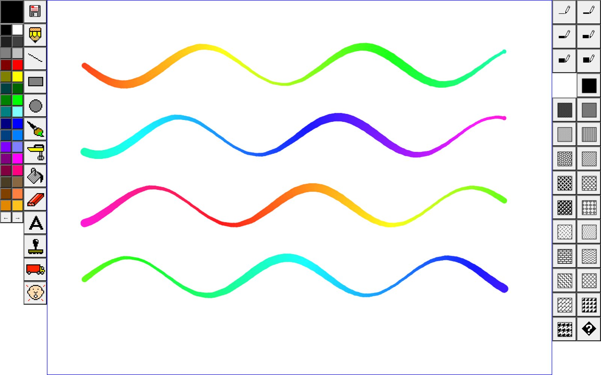

# Kid Pix for Android

[JS Kid Pix](https://github.com/vikrum/kidpix) as a native Android tablet app, with real pen support.




## Install

Grab the APK from [Releases](https://github.com/davidguttman/kidpix-android/releases/latest), open it on the tablet, and allow installs from your browser or file manager when Android asks. Needs Android 10 or newer.

## Pen support

Works with Android active pens: Lenovo Tab Pen / Tab Pen Plus, USI, MPP, Wacom AES/EMR, S Pen.

- **Pressure** changes line size for the pencil, brushes and eraser
- **Hover** previews stamps, letters and the eraser under the pen tip before you touch down
- **Side button 1 (hold) or the eraser end** erases; your tool comes back when you lift
- **Side button 2** is undo (press twice quickly to redo)
- **Palm rejection**: fingers on the canvas are ignored while the pen is down, hovering, or just lifted. Fingers still draw when there's no pen around.
- Pen samples are delivered unbuffered, and the pencil uses every sample for smooth lines
- On tablets that support it, the stroke in progress is drawn on a low-latency layer (kept only where the app measures it to be faster)

Some tablets bind pen side buttons to system shortcuts (notes, screenshots). If a button does that instead, turn the shortcut off in the tablet's pen settings.

## Tablet niceties

- **Undo Guy**: tap to go back a step (up to 30), double-tap to go forward again
- The selected tool shows inverted (MacPaint-style); the selected size/ink/brush gets a thick black frame
- While the pen hovers, the current tool's icon floats next to the tip (the eraser while the side button is held)
- Fullscreen landscape: tools on the left, tool options on the right, the canvas fills the rest
- **Save** puts a PNG in `Pictures/Kid Pix`; the **folder** button under it shows saved pictures as thumbnails, and tapping one opens it (undo brings back what you had). The picker only shows pictures saved by Kid Pix itself. Clearing the app's storage or reinstalling hides older ones from it (they stay in the Gallery), because Android only lets an app see its own pictures without a photo permission.
- The **door** button at the bottom of the tools leaves the app; your drawing is still there when you come back
- If the app is closed or killed, the drawing, tool and colours are there when it opens again

## How it's built

A native Android app in Kotlin: no WebView. Upstream JS Kid Pix is a git submodule at `upstream/` and isn't modified; its pictures and sounds are copied into the APK at build time, and its drawing code is translated to Kotlin file for file, with the same names.

- `kidpix/` is the app. `Ctx2D` gives the translated code the browser's Canvas2D API on top of `android.graphics`, so each upstream file is one Kotlin file, close to line for line. `kidpix/CONVENTIONS.md` is the guide to the code.
- `glfx/` is a small library with the WebGL effects of upstream's `glfx.js` (swirl, pancake stack) on OpenGL ES 2.0 with the same shaders.
- `app/` and `overlay/` are the earlier WebView version (up to 0.5.2), kept as the reference the native app is compared against. It is not what gets released.
- `ref/` has scripted test drawings for every option of every tool and the pictures the WebView version made of them.

```bash
git clone --recursive https://github.com/davidguttman/kidpix-android
cd kidpix-android
./gradlew :kidpix:assembleDebug        # JDK 17 or 21, Android SDK 35
```

## Tests

```bash
./gradlew :kidpix:testDebugUnitTest    # unit tests, on the computer (no device)

# draw one group of test drawings without a device and compare with the reference pictures
./gradlew :kidpix:renderScenarios -Pscenarios=$PWD/ref/scenarios/brush.json -Pout=/tmp/kp/brush
uv run scripts/compare.py ref/out /tmp/kp/brush --only 'brush-*'

./gradlew :kidpix:connectedDebugAndroidTest   # on a device or emulator: pen layer, save/open/undo, emoji glyphs
```


## Releasing

Bump `versionCode` and `versionName` in `kidpix/build.gradle.kts`, add `docs/release-notes/vX.Y.Z.md`, commit, then run `scripts/release.sh`.

## Credits and license

Kid Pix 1.0 by Craig Hickman, released into the public domain. JS Kid Pix by [vikrum](https://github.com/vikrum/kidpix). This Android port is GPL-3.0, like JS Kid Pix.
