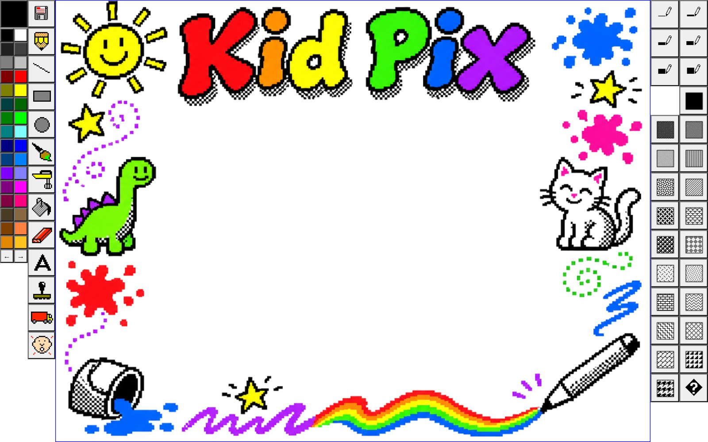

# Kid Pix for Android

[JS Kid Pix](https://github.com/vikrum/kidpix) as an Android tablet app, with real pen support.




## Install

Grab the APK from [Releases](https://github.com/davidguttman/kidpix-android/releases/latest), open it on the tablet, and allow installs from your browser or file manager when Android asks. Needs Android 10 or newer.

## Pen support

Works with Android active pens: Lenovo Tab Pen / Tab Pen Plus, USI, MPP, Wacom AES/EMR, S Pen.

- **Pressure** changes line size for the pencil, brushes and eraser
- **Hover** previews stamps, letters and the eraser under the pen tip before you touch down
- **Side button 1 (hold) or the eraser end** erases; your tool comes back when you lift
- **Side button 2** is undo
- **Palm rejection**: fingers on the canvas are ignored while the pen is down, hovering, or just lifted. Fingers still draw when there's no pen around.
- Pen samples are delivered unbuffered, and the pencil uses every sample for smooth lines

Some tablets bind pen side buttons to system shortcuts (notes, screenshots). If a button does that instead, turn the shortcut off in the tablet's pen settings.

## Tablet niceties

- Fullscreen landscape: tools on the left, tool options on the right, the canvas fills the rest
- **Save** puts a PNG in `Pictures/Kid Pix`; the **folder** button under it shows saved pictures as thumbnails, and tapping one opens it (undo brings back what you had). The picker only shows pictures saved by Kid Pix itself. Clearing the app's storage or reinstalling hides older ones from it (they stay in the Gallery), because Android only lets an app see its own pictures without a photo permission.
- Your drawing is still there when you come back to the app
- Links to outside websites are blocked, so kids stay in the app
- If the browser engine crashes, the app reloads with the drawing intact instead of closing

## How it's built

Upstream JS Kid Pix is a git submodule at `upstream/` and isn't modified. The Android layer sits on top:

- `overlay/android.js` replaces the mouse/touch input with Pointer Events (pressure, hover, pen buttons, palm rejection), sizes the canvas to the screen, and saves to the gallery
- `overlay/android.css` is the tablet layout
- `app/` is a small Kotlin WebView app that serves the files locally
- `scripts/build-web.sh` assembles upstream + overlay into the APK assets (runs automatically before each build; no npm needed)

```bash
git clone --recursive https://github.com/davidguttman/kidpix-android
cd kidpix-android
./gradlew assembleDebug        # JDK 17+, Android SDK 35
```

## Tests

On a debug build, with the app open on a device or emulator:

```bash
adb forward tcp:9333 localabstract:webview_devtools_remote_$(adb shell pidof dev.kidpix.tablet)
uv run --with websockets scripts/pen_test.py 9333    # pressure, side buttons, eraser, palm, hover, stuck-stroke recovery
uv run --with websockets scripts/tool_smoke.py 9333  # every tool x every option with pen taps and strokes
```

## Releasing

Bump `versionCode` and `versionName` in `app/build.gradle.kts`, add `docs/release-notes/vX.Y.Z.md`, commit, then run `scripts/release.sh`.

## Credits and license

Kid Pix 1.0 by Craig Hickman, released into the public domain. JS Kid Pix by [vikrum](https://github.com/vikrum/kidpix). This Android port is GPL-3.0, like JS Kid Pix.
